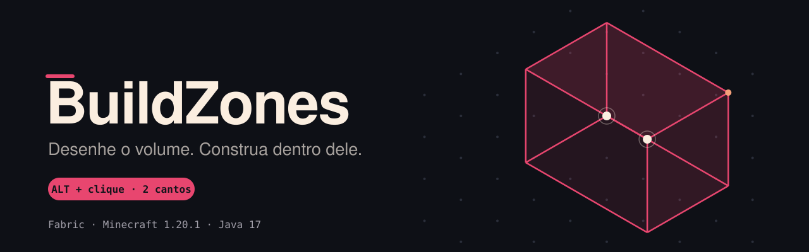
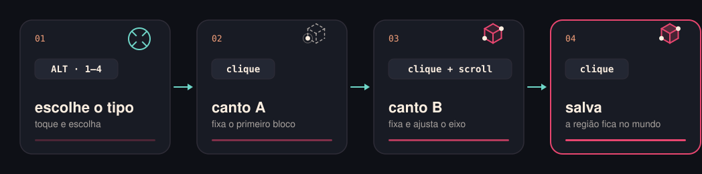
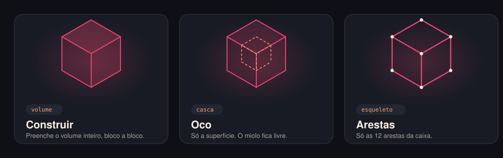
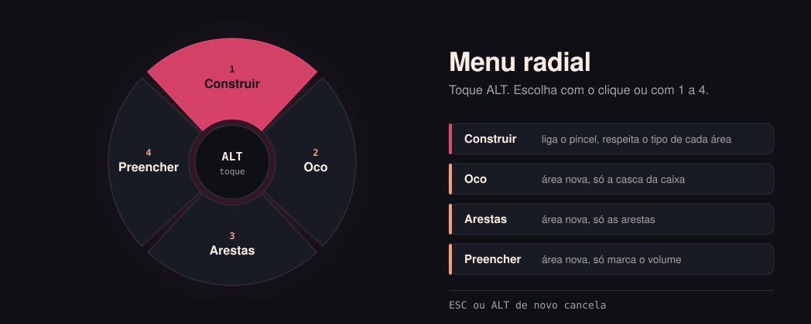

<p align="center">
  
</p>

<p align="center">
  <a href="https://github.com/midihellish/SelectionTools/releases/latest"></a>
  <a href="docs/CONTROLS.md"></a>
  <a href="CHANGELOG.md"></a>
</p>

<p align="center">
  
  
  
  
  
</p>

<p align="center">
  <b>Marque dois cantos, veja o volume em translúcido e construa dentro dele.</b><br>
  <sub>Seleções visuais por mundo, pincel de área e troca de blocos validada pelo servidor.</sub>
</p>

---

## Como funciona

<p align="center">
  
</p>

Toque <kbd>ALT</kbd>, escolha o tipo de área e marque os cantos. A região fica salva no mundo e aparece como um volume translúcido, com pulso suave e fantasmas dos blocos.

## Tipos de área

<p align="center">
  
</p>

Cada região guarda o próprio tipo. Regiões se sobrepõem sem alterar as anteriores.

## Menu radial

<p align="center">
  
</p>

---

## O que tem

<table>
  <tr>
    <td width="33%" valign="top">
      <h4>Seleção por dois cantos</h4>
      <sub>Mire, marque A e B, ajuste com o scroll e salve. O canto para na superfície, sem entrar no bloco.</sub>
    </td>
    <td width="33%" valign="top">
      <h4>Várias regiões</h4>
      <sub>Regiões independentes e sobrepostas, salvas por mundo e por dimensão.</sub>
    </td>
    <td width="33%" valign="top">
      <h4>Desfazer e limpar</h4>
      <sub>Volta a última região ou limpa todas as do mundo atual.</sub>
    </td>
  </tr>
  <tr>
    <td width="33%" valign="top">
      <h4>Modo área</h4>
      <sub>Clique direito coloca, esquerdo quebra. Só dentro das áreas, respeitando o tipo de cada uma.</sub>
    </td>
    <td width="33%" valign="top">
      <h4>Smart Replacement</h4>
      <sub>ALT + clique direito troca o bloco mirado. O servidor refaz o raycast e valida alcance e permissão.</sub>
    </td>
    <td width="33%" valign="top">
      <h4>Tecla configurável</h4>
      <sub>O modificador é um KeyBinding comum, em Controles, categoria Selection Tools.</sub>
    </td>
  </tr>
</table>

---

## Instalação

1. Instale o [Fabric Loader](https://fabricmc.net/use/) `0.20.1` no Minecraft `1.20.1`.
2. Coloque o [Fabric API](https://modrinth.com/mod/fabric-api) `0.92.12+1.20.1` em `mods/`.
3. Baixe o `selection-tools-<versão>.jar` nos [releases](https://github.com/midihellish/SelectionTools/releases/latest) e coloque também em `mods/`.

> O jar é só para Fabric. Não serve para NeoForge.

### Multiplayer

| Recurso | Precisa do mod em |
|---|---|
| Seleções e visualização | Só no cliente. Funciona em qualquer servidor |
| Smart Replacement | Cliente e servidor |
| Modo área (colocar e quebrar) | Cliente e servidor |

---

## Controles

| Ação | Atalho |
|---|---|
| Abrir o menu radial (ou parar a ação em curso) | <kbd>ALT</kbd> (tocar e soltar) |
| Escolher uma ação no menu | <kbd>clique</kbd> numa fatia, ou <kbd>1</kbd> a <kbd>4</kbd> |
| Marcar o canto A, o canto B e salvar | <kbd>clique esquerdo</kbd> ou <kbd>clique direito</kbd>, três vezes |
| Ajustar a caixa antes de salvar | <kbd>scroll</kbd> |
| Cancelar a escolha ou o rascunho | <kbd>ESC</kbd> ou tocar <kbd>ALT</kbd> |
| Desfazer a última região | <kbd>ALT</kbd> + <kbd>Z</kbd> |
| Limpar as regiões do mundo | <kbd>ALT</kbd> + <kbd>F</kbd> |
| Colocar no modo área | <kbd>clique direito</kbd> |
| Quebrar no modo área | <kbd>clique esquerdo</kbd> |
| Trocar o bloco mirado | <kbd>ALT</kbd> + <kbd>clique direito</kbd> |

Regras e casos de borda em [docs/CONTROLS.md](docs/CONTROLS.md).

---

<details>
<summary><b>Para desenvolver</b></summary>

<br>

```bash
export JAVA_HOME=$HOME/.gradle/jdks/eclipse_adoptium-21-amd64-linux.2
export PATH=$JAVA_HOME/bin:$PATH

./gradlew build      # compila, testa e gera o jar em build/libs/
./gradlew runClient  # abre um cliente de desenvolvimento
```

Use JDK 21 (o JDK 25 não foi testado com Gradle 8.8). O código comum fica em `src/main` e nunca referencia `net.minecraft.client.*`. Detalhes em [CLAUDE.md](CLAUDE.md) e [docs/ARCHITECTURE.md](docs/ARCHITECTURE.md).

</details>

<details>
<summary><b>Documentação</b></summary>

<br>

| Arquivo | Conteúdo |
|---|---|
| [Controles](docs/CONTROLS.md) | Todas as entradas e regras |
| [Arquitetura](docs/ARCHITECTURE.md) | Camadas, fluxo e persistência |
| [Substituição](docs/REPLACEMENT_COMPATIBILITY.md) | Smart Replacement e compatibilidade |
| [Renderização](docs/RENDERING_NOTES.md) | Camadas, geometria e animações |
| [Testes](docs/TEST_PLAN.md) | Testes automáticos e manuais |
| [Changelog](CHANGELOG.md) | O que mudou em cada versão |

</details>

---

<p align="center"><sub>Todos os direitos reservados.</sub></p>
